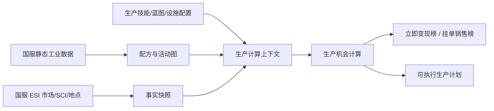

# 工业制造与市场机会分析：功能详细设计

## 1. 总体流程

系统将静态配方、动态 ESI 快照和用户配置分层，不把市场瞬时价格写入蓝图主数据。

## 2. 生产配置

生产配置可保存、复制、启停和版本化，至少包含：生产主体、生产技能等级、市场费用、候选生产地点、活动生产线、默认蓝图 ME/TE、目标周期、市场占比上限和数据新鲜度门槛。

设施档案至少包含：地点类型（实际/假设）、星系、安等、建筑 hull、支持活动、在线服务、Rig type、设施税、参数来源、确认时间和备注。自动读取的 SCI/安等/Dogma 是事实字段；服务、Rig、税率和 NPC 能力矩阵允许人工覆盖。

## 3. 机会计算

每个候选结果的主键语义是“产品 + 蓝图 + 生产配置 + 计算快照”。计算顺序如下：

1. 校验静态配方来源、活动类型、产品可交易性和版本状态。
2. 根据目标周期、活动生产线、蓝图 runs 与安全市场占比计算推荐批量：`推荐数量 = min(目标周期产能, 安全可消化产量, BPC 可产出量)`；BPO 不受 runs 限制，BPC 不得超过剩余 runs。
3. 按蓝图 ME、设施材料加成和国服规则计算材料数量；所有材料从吉他 4-4 订单簿逐档采购。
4. 按蓝图 TE、角色技能、设施/Rig 时间加成计算活动时间；制造、反应、发明和研究使用各自活动参数。
5. 以 ME0 基础材料和国服 adjusted price 计算 EIV，再叠加 activity SCI、设施成本加成、设施税及版本化费用。
6. 用吉他买单逐档计算立即变现收入；用挂单价格、经纪费、销售税和预计售出时间计算挂单收入。
7. 用伏尔戈日历史计算 7/30 日销量、波动、趋势和可消化产量；订单深度不足时降低批量或标记风险。
8. 输出单件利润、利润率、每线小时利润、每日可实现利润、资金占用、预计售罄时间和风险标签。

### 核心派生指标

- `材料采购成本`：按目标材料数量从最低卖单开始逐档累加；深度不足时记录缺口，不用最后一档价格无限外推。
- `立即变现收入`：按目标成品数量从最高买单开始逐档累加，再扣交易税。
- `挂单预期收入`：目标挂单价 × 可消化数量，扣经纪费和交易税；它是预期值，不声明已经成交。
- `安全可消化产量`：默认取 `30 日平均日销量 × 目标天数 × 市场占比上限`，再结合当前订单深度、整数件数、7 日趋势与异常日修正。
- `每日可实现利润`：以实际推荐批量的收入减去材料、安装费和市场费用，再按生产与预计销售周期折算；不能用单件利润简单乘理论最大产量。
- `综合评分`：利润能力 40%、流动性 20%、利润率 15%、价格稳定性 10%、设施确定性 10%、数据新鲜度 5%；权重版本化并允许管理员调整。
- T2 结果必须带 `蓝图已就绪且成本为零` 假设标签；发明/复制/逆向工程的材料、失败概率和工时不进入首版利润。

## 4. 机会状态与风险

`可执行`要求配方已验证、活动资格成立、SCI/市场/设施关键参数完整且在新鲜度门槛内；`可试算`允许估算税率、回退配方或过期市场，但不得进入正式榜单；`不可执行`表示活动不支持、关键来源缺失或没有可交易/可消化市场。

风险标签至少包括：订单深度不足、历史销量为星域口径、价格波动、配方未验证、设施参数估算、SCI/市场过期、蓝图前置活动未计成本、预计售罄过长和资金占用过高。界面显示风险分数与触发原因，不只显示一个高/中/低等级。

## 5. 页面与接口

### 生产机会

顶部筛选产品分类、活动、生产配置、地点状态、机会状态和数据时间；表格同时展示两种榜单，可按综合评分、每日利润、利润率、每线小时利润、资金占用和风险排序。详情抽屉展示物料清单、逐档采购、工时、安装费、销量依据、来源快照和风险原因。

### 配置维护

生产配置、设施档案、技能档案、蓝图覆盖配置和市场费用配置独立维护，可复制生成新版本。删除只做归档，已引用配置不能物理删除。

### 生产计划

从可执行机会生成计划，保存推荐批量或用户覆盖批量；计划固定计算快照。市场/SCI 更新后标记“有更新”，由用户复制计划重新计算，不覆盖旧结果。

### 关键接口

| 接口 | 用途 |
| --- | --- |
| `GET /eve/industry/opportunities` | 分页查询机会和榜单 |
| `POST /eve/industry/opportunities/scan` | 手工触发指定范围扫描 |
| `GET/POST /eve/industry/configs` | 生产配置维护 |
| `GET/POST /eve/industry/facilities` | 设施档案维护 |
| `GET/POST /eve/industry/blueprints` | 蓝图 ME/TE/runs 覆盖维护 |
| `GET/POST /eve/industry/plans` | 生成、保存、复制生产计划 |
| `GET /eve/industry/snapshots/{id}` | 查看计算快照与来源 |
| `GET /eve/industry/data-status` | 查看静态配方、市场、SCI 和设施数据状态 |
| `POST /eve/industry/golden-cases/validate` | 导入/执行 Golden Case 校验 |

## 6. 调度与容错

每日生成一次全量机会快照；手工扫描只计算用户指定范围。订单、历史和 SCI 同步失败时保留上次完整快照并降级为可试算/不可执行；不把失败响应当成零销量、零税率或零 SCI。静态配方版本变化时暂停正式榜单，直到重新校验。
