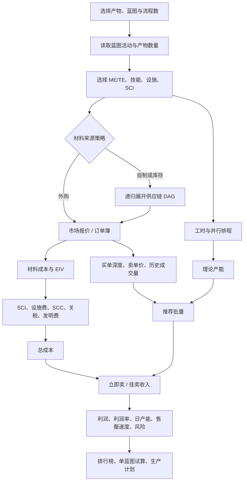
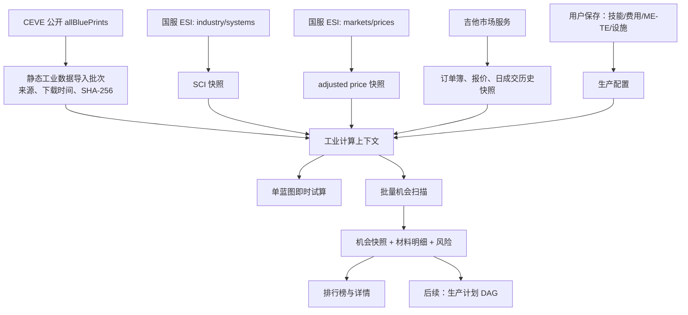

# ceve-industry.cn 业务逻辑、计算公式与数据流

调研日期：2026-09-27（北京时间）
调研对象：http://www.ceve-industry.cn/（国服模式）
证据：公开页面、页面加载的公开 JSON 接口、浏览器下发的前端计算代码。本文把“网站实际行为”和“本项目采用的规则”分开描述，避免把第三方站点的实现细节误当成国服官方事实。

## 1. 一句话结论

该网站的核心不是“查一张蓝图的材料价”，而是以**目标产物**为起点，构建“蓝图—中间产品—外购材料”的有向无环图（DAG），在每个工序上计算材料、工时、安装费、前置发明费和市场费用，最后把整条供应链汇总为利润、产能和市场承接能力。

本项目的固定口径是：

- 仅国服 Serenity；
- 原料从吉他海军第四空间站购买，产品也按该站销售；
- 默认无库存、不递归自制材料、不计算运输与蓝图购置成本；
- 使用用户保存的蓝图 ME/TE、技能、设施、安等、Rig、SCI、设施税与附加费；
- 同时给出“立即卖给买单”和“挂卖单”的结果，并用市场成交量限制可实现利润。

因此，网站是规则参考和功能地图；本项目的订单簿逐档成交、结果快照和国服数据来源追溯是刻意增强，不能为了表面复刻而退化掉。

## 2. 业务逻辑地图



### 2.1 网站功能与对应的业务职责

| 网站页面 | 业务职责 | 关键输入 | 关键输出 |
| --- | --- | --- | --- |
| 蓝图计算 | 单产品或多产品的完整供应链核算 | 蓝图、流程数、ME/TE、解码器、设施、库存、采购/自产策略 | 物料树、工序、费用拆分、利润与工时 |
| 利润排行 | 对筛选蓝图批量运行同一套核算 | 分类、蓝图、市场和设施设置 | 单件/日利润、利润率、日产量、日成交量、出货效率 |
| 生产规划 | 把多产品需求变成可执行的工序 DAG | 产品数量、库存、并行策略、BPO/BPC 约束 | 分组工序、线数、时长、依赖和状态 |
| 产品建议 | 用已有材料反查可生产产品 | 材料清单、库存、分类与策略 | 可做产品及其利润/市场指标 |
| 化矿与化矿套利 | 比较直接出售和提炼后出售 | 输入物品、提炼率、税、价格源 | 产物、税、差额与利润率 |
| 资产估价 | 粘贴资产/合同并给出处理建议 | 名称、数量、市场/提炼数据 | 直接卖、化矿卖和价格/体积比较 |
| 价格对比 | 多地点多口径的物品价格分析 | 类别、地点、列配置、公式列 | 买卖价、差价、量、成交额 |
| 人工/ESI 库存、工业任务 | 为计划提供可抵扣的输入和执行状态 | 人物/军团资产、任务、人工库存 | 可用库存、占用量和任务状态 |

### 2.2 网站蓝图计算的决策顺序

1. 取得目标蓝图的制造活动、单位流程产物数、基础材料、基础时长和蓝图类型。
2. 用产品数量反推流程数；BPC 受最大流程数约束。
3. 对每种材料应用 ME 与设施材料倍率，并在材料层向上取整。
4. 若材料被配置为“自产”，继续展开其生产蓝图；若有库存，先抵扣库存；剩余部分才按市场价购买。
5. 对每个展开的制造/反应工序计算时间、SCI、建筑费、SCC 和可选的 PI 关税。
6. 对 T2/T3 蓝图，按发明/逆向概率和解码器材料追加预期前置成本。
7. 汇总叶子材料、前置活动、安装费、市场费和运输费；汇总最终产物收入。
8. 用总工时推理论日产能，再与历史日成交量比较，显示出货效率而非强制截断利润。

本项目在第 4 步固定为“全部外购、库存为零”，在第 6 步当前只展示前置活动，成本为零假设必须显示风险标签；第 8 步则把成交量和订单深度真正纳入推荐批量，符合“利润高且有市场”的目标。

## 3. 统一符号与单位

后续代码和接口必须使用以下单位，杜绝把“流程数”和“产物件数”混用：

| 符号 | 含义 | 单位 |
| --- | --- | --- |
| `Q` | 目标产物数量 | 件 |
| `q` | 蓝图每流程产物数量 | 件/流程 |
| `R` | 必需流程数，`ceil(Q / q)` | 流程 |
| `m_i` | 第 `i` 种基础材料的 ME0 单流程需求 | 件/流程 |
| `ME`、`TE` | 蓝图材料/时间研究等级 | 等级 |
| `F_m`、`F_t`、`F_c` | 设施材料、时间、费用倍率 | 无量纲倍率 |
| `S` | 当前活动的星系成本指数（SCI） | 比率 |
| `p_i` | 市场订单第 `i` 档的单价 | ISK/件 |
| `v_i` | 市场订单第 `i` 档剩余数量 | 件 |
| `a_i` | 物品的 adjusted price | ISK/件 |
| `T0` | 蓝图基础时间 | 秒/流程 |
| `L` | 可并行生产线数 | 条 |

## 4. 可复核的计算公式

### 4.1 材料

网站的普通制造材料倍率为：

```text
M_material = (0.90 + 0.01 × (10 - clamp(ME, 0, 10))) × F_m
```

因此单次任务中第 `i` 种材料的实际需求为：

```text
need_i = ceil(m_i × R × M_material)
```

网站中反应将 ME 固定为 `0`，但仍应用设施材料倍率；行星工业不应用这条 ME 公式，倍率为 `1`。T2 发明产生的蓝图，会以 `ME = 2 + 解码器材料效率修正` 作为下游制造的默认 ME。

网站源码存在 `m_i = 1` 时为“平均消耗量”保留小数的展示分支；但真正的任务采购量必须以 `ceilQuantity` 为准。本项目统一只使用上式得到的整数任务数量。

示例：基础材料 `916`，ME10、无设施材料加成、`R=1`，则 `ceil(916 × 0.9) = 825`。这与网站“小型护盾扩展装置 I”的显示结果一致。

### 4.2 工时

网站的活动时间倍率：

```text
普通制造：M_time = F_t × 0.68 × (1 - 0.02 × clamp(TE, 0, 20)) × C_t
反应：    M_time = F_t × 0.80 × C_t
行星工业：使用自身活动规则，不走上述普通制造/反应倍率

duration = T0 × R × M_time
```

`C_t` 是网站的“自定义工业时间倍率”；本项目对应保存的固定生产技能时间倍率。网站默认 ME10、TE5 时，普通制造的角色与 TE 部分为 `0.68 × 0.90 = 0.612`。

### 4.3 EIV 与安装费

网站 `getEiv(product)` 的定义是每个产物的基础工业估值：

```text
EIV_per_output = Σ(m_i × a_i) / q
```

将它换算为任务级成本基础后：

```text
EIV_job = EIV_per_output × Q = Σ(m_i × a_i) × R
```

其中 `m_i` 始终为 ME0 基础材料，`a_i` 为 adjusted price；EIV **不等于**玩家实际买料成本。

网站对非 PI 生产叠加：

```text
solarSystemFee     = S × EIV_job
structureFee       = structureFeeRate × EIV_job
safetyCommitteeFee = 0.04 × EIV_job
```

其中制造取制造 SCI，反应取反应 SCI；行星工业不加固定 4% SCC。网站还可叠加 PI 关税、市场费、发明费和运输费。

本项目的设施配置将上述结果归并为：

```text
installationCost = EIV_job × (S × F_c + facilityTax + versionedSurcharge + 0.04)
```

`versionedSurcharge` 必须保留为可配置且由国服 Golden Case 校验，不能把第三方网站的 `0.04` 之外任何费率当作国服不变事实。

### 4.4 订单簿、收入与利润

网站大多数页面默认从指定市场快照中取得“最低卖单”或“最高买单”这一代表性单价；可切换为 1 日/20 日成交均价、买卖中间价或自定义价。其数据源结构并没有在利润页按深度逐档模拟成交。

本项目应继续采用更严格的逐档成交公式。给定需要成交的数量 `x`：

```text
fill_i = min(v_i, max(0, x - Σ(前序 fill)))
orderBookAmount = Σ(p_i × fill_i)
```

用途如下：

| 场景 | 订单排序 | 金额含义 |
| --- | --- | --- |
| 采购原料 | 卖单价格升序 | 完整采购成本；深度不足则产生缺口 |
| 立即变现 | 买单价格降序 | 立刻卖出的毛收入；深度不足则不能宣称全量可成交 |
| 挂卖产品 | **不是吃现有卖单** | 应选择挂单策略价，再受预计可消化数量限制 |

挂单销售的正确合同应为：

```text
grossSellRevenue = listPrice × sellableQuantity
netSellRevenue   = grossSellRevenue × (1 - salesTax - brokerFee)
```

`listPrice` 可采用“当前最低卖单减一个合法价格步长”或用户指定策略价；`sellableQuantity` 不能超过可消化产量。现有原型中用现有卖单的逐档金额作为 `sellOrderRevenue`，这只可作为“当前卖方价格带参考”，不能视为真实挂单收入，正式生产机会要按本节修正。

总成本与两种利润：

```text
totalCost       = materialPurchaseCost + installationCost
                  + customsFee + inventionCost + transportCost
immediateProfit = immediateNetRevenue - totalCost
sellProfit      = netSellRevenue - totalCost
margin          = sellProfit / totalCost             （totalCost > 0）
```

本项目固定 `transportCost = 0`、`blueprintCost = 0`、默认 `inventionCost = 0`，但这些假设必须进入结果快照和风险标签。

### 4.5 市场承接能力、推荐批量与每日可实现利润

网站展示的指标为：

```text
dailyQuantity       = Q / duration × 86400
dailyVolume         = 市场平均日成交量
shippingEfficiency  = dailyVolume / dailyQuantity
dailyBusinessVolume = dailyVolume × 市场平均成交价
```

它主要用于展示，并不以日成交量硬性截断利润。为了得到“有市场”的可执行结论，本项目采用：

```text
safeDemand = floor(averageDailyVolume × targetDays × marketShareLimit)
sellableQuantity = min(safeDemand, productBuyOrderDepth, plannedOutputQuantity)

capacityOutput = floor(86400 × targetDays × L / timePerRun) × q
plannedOutput  = min(safeDemand, capacityOutput, BPCRemainingRuns × q)
```

若任一原料卖单深度或成品立即买单深度不足，应标记 `ORDER_DEPTH_INSUFFICIENT`，不得把最后一档价格外推。挂单场景可不用买单深度作为销量上限，但仍必须受 `safeDemand` 和预计售罄时间约束。

最终推荐的每日可实现利润应采用已受市场限制的批量，并以生产与销售中较慢的一侧折算：

```text
productionDays = duration / (86400 × L)
sellingDays    = Q / max(averageDailyVolume × marketShareLimit, 1)
realizationDays = max(productionDays, sellingDays)
dailyRealizedProfit = sellProfit / realizationDays
```

这比“单批利润 ÷ 工时 × 24 × 线数”更符合市场容量不足时的实际结果。

### 4.6 发明与 T3 逆向工程（网站已实现、项目后续接入）

网站将前置活动的单次材料成本记为 `C_attempt`，基础成功率记为 `P_base`。解码器可能同时改变流程产出 `n`、ME/TE 和成功率增量 `p_decoder`：

```text
P = P_base × inventionAddition × (1 + p_decoder)
attemptsExpected = requiredBlueprintRuns / (n × P)
inventionCostExpected = C_attempt × attemptsExpected
```

随后将预期发明成本分摊到下游制造产物。T3 逆向工程沿用同一预期值结构，只是前置材料包含古代遗物及不同的活动数据。网站也允许将“发明成本为零”作为显式设置。

概率活动应同时返回：期望成本、向上取整的实际尝试次数、成功概率和高波动风险；不得把期望值伪装为确定成本。

### 4.7 化矿

给定 `quantity` 和物品 `portionSize`：

```text
processable = floor(quantity / portionSize)
remainder   = quantity mod portionSize
output_i    = floor(baseOutput_i × processable × refinePercent)
refineTax   = Σ(adjustedPrice_i × output_i × refineTaxRate)
```

网站标准矿/冰矿类默认 `refinePercent = 0.906`，特殊类固定 `0.95`，装备默认 `0.55`；它将不能凑足一份的 `remainder` 原样保留。套利页比较“输入物品售价”与“提炼产物售价 - 提炼税 - 可选运输”，可为本项目的资产估价模块复用。

### 4.8 并行排程

网站先取得 `R` 与每流程时长，再按下列策略切分生产线：

- 按指定并行线数；
- 按单线最大小时数；
- 按单线最大流程数；
- 固定流程数或固定小时数；
- 默认策略：BPC 的 `maxProductionLimit` 与最大单线时长（默认 720 小时）共同限制。

切分可选择“平均分摊”或“满线加余数”。计划状态使用：未启动、生产中、可交付、已交付。该能力应建立在统一的 `R`（流程）单位上，而不是把最终产物件数直接作为流程数。

## 5. 网站数据流

```mermaid
flowchart LR
    subgraph External[网站公开数据]
      BP[/allBluePrints/]
      TM[/allTypeMaterials/]
      MD[/allMarketDump/]
      MH[/allMarketHistory/]
      II[/industryIndices/]
      EP[/estimatedPriceList/]
      DP[/dealPriceList/]
      OD[/orders/{location}/]
    end
    subgraph Browser[ceve-industry.cn 浏览器端]
      R[Redux PriceDataReducer]
      DB[Dexie IndexedDB\n按服务器隔离]
      SET[redux-persist/localForage\n设置、设施、库存、页签]
      CALC[供应链计算器]
      PAGES[计算 / 排行 / 化矿 / 计划 / 估价]
    end
    External --> R
    R <--> DB
    SET --> CALC
    R --> CALC
    CALC --> PAGES
```

网站 Dexie 中已观察到的表/键包括：`updateAt`、`marketDump250207`、`allBlueprint`、`allTypeMaterials`、`estimatedPriceListV3`、`industryIndices`、`dealPriceList`、`order250209`、`allMarketHistory`。用户配置则持久化在浏览器本地；这适合个人工具，不适合军团协作和结果复盘。

网站支持可选 ESI 授权，将个人/军团资产、工业任务、玩家建筑和结构市场订单接入库存和任务页。该授权链不得迁移其 client ID、令牌或本地存储方式；本项目必须复用自身国服 ESI 授权体系。

## 6. 本项目目标数据流



### 6.1 数据源、用途与信任边界

| 数据 | 当前来源 | 用途 | 不可替代的原因 |
| --- | --- | --- | --- |
| 蓝图、材料、产物、基础时间 | CEVE 公开 `allBluePrints`，落为有 SHA-256 的导入批次 | 制造/反应配方 | 必须记录第三方版本和校验状态 |
| SCI | 国服 ESI `/industry/systems/` | 制造/反应安装费 | 不能拿国际服指数或缺失值当 0 |
| adjusted price | 国服 ESI `/markets/prices/` | EIV/安装费 | 不是玩家买卖市场价 |
| 吉他报价、订单、历史 | 既有 `EveMarketService` 的固定吉他口径快照 | 采购、立即变现、挂单定价和需求 | 所有物品必须处于同一市场地点和时间语境 |
| 设施、Rig、安等、税、线数 | 本项目设施档案 | 材料/时间/费用和资格 | 用户人工确认，保留来源与确认时间 |
| ME、TE、BPO/BPC | 本项目蓝图覆盖 | 材料、时间、流程上限 | 蓝图本身不计成本 |
| 角色技能、市场税/经纪费 | 本项目生产配置 | 工时和净收入 | 当前为固定可配置参数，不绑定真实角色 |

### 6.2 当前接口调用链

1. `POST /eve/industry/static-versions/sync-ceve` 拉取公开蓝图，校验结构、计算 SHA-256，保存 `CEVE_INDUSTRY_PUBLIC` 导入批次与蓝图活动。
2. 用户保存生产配置、设施档案和蓝图覆盖；设施 SCI 可由 `POST /eve/industry/facilities/{id}/sync-sci` 刷新。
3. `POST /eve/industry/calculate` 获取一张蓝图的材料和成品类型，按需补齐有限吉他订单/历史快照，计算单次结果并返回告警。
4. `POST /eve/industry/opportunities/scan` 读取候选蓝图，受批量上限约束补齐市场数据和 adjusted price，按机会计算后保存机会与材料明细。
5. `GET /eve/industry/opportunities` 读取最近扫描批次，`GET /eve/industry/opportunities/{id}/materials` 复盘实际采用的材料数量和采购金额。

每一份正式机会/计划后续都应固化：静态版本、配置版本、设施版本、SCI/adjusted price 取得时间、订单档位、历史成交数据、规则版本和风险标签；不能只保存聚合金额。

## 7. 已发现的实现对齐项

以下是根据本次公式审查得到的上线前修正清单，不是对已确认业务口径的变更：

| 优先级 | 对齐项 | 原因与正确约束 |
| --- | --- | --- |
| P0 | 统一 `runs` 与 `productQuantity` 的语义 | API、计算器、扫描器和计划器必须明确传递 `Q` 或 `R`，且只在边界用 `R = ceil(Q / q)` 转换一次；多产物蓝图不能再二次除以 `q`。 |
| P0 | 修正挂卖收入模型 | 挂卖应由挂单策略价 × 可卖数量计算，不能把现存卖单逐档“吃掉”当作自己挂单的收入。 |
| P0 | 将销量约束用于日利润 | 生产产能、可消化销量和预计售罄时间必须共同决定日利润；销量小于产能时不可继续按满产日利润排行。 |
| P1 | 机会快照固化订单档位与来源时间 | 当前材料明细保存聚合采购结果，还不足以审计某次利润为何变化。 |
| P1 | 接入供应链 DAG 与生产计划 | 当前固定全部外购符合默认口径；但多产品规划、可选库存、自产中间件和排程须作为显式模式实现。 |
| P2 | 接入发明、复制和 T3 逆向 | 保持“蓝图本体不计成本”的已确认口径，但将概率前置活动的预期成本、工时和风险作为可选计算层。 |
| P2 | 接入化矿、资产估价和产品建议 | 复用市场、类型与计划数据，不要为每个页面另建一套价格口径。 |

## 8. 不能照搬的网站行为

- 网站大量采用浏览器 IndexedDB/localForage；本项目必须以 MySQL 快照和租户隔离保存可审计数据。
- 网站利润页的单一报价不足以评估真实的大批量采购与立即变现；本项目保留订单簿深度。
- 网站允许客户端自由公式列；本项目若提供价格对比计算，只能使用受限公式 DSL 或固定字段组合，禁止执行任意 JavaScript。
- 网站支持多个服务器；本项目不混入 TQ、晨昏服等数据。
- 网站的公开数据刷新频率、完整性和是否严格对应当前国服客户端均未得到官方证明；导入批次必须显示来源和新鲜度，Golden Case 只作为差异记录和回归证据，不阻塞按已采用规则的试算。

## 9. 证据索引

- 公开蓝图：`http://8.210.18.81:8080/pricedata/allBluePrints`
- 市场/规则相关公开接口：`allMarketDump`、`allMarketHistory`、`industryIndices`、`estimatedPriceList`、`dealPriceList`、`orders/{regionOrStation}`、`marketHistoryDays/{typeId}/6`。
- 页面下发脚本中的核心方法：`getMaterialReducePercent`、`getTimeReducePercent`、`getEiv`、`getResourceList`、`generateContextSummary`、`getParallelConfig`、`getInventPipeline`、`getT3InventPipeline`、`getBlueprintProfitSummary`。
- 本项目对应实现：`EveIndustryCalculator`、`EveIndustryService`、`EveMarketService` 与工业制造页面/API。
